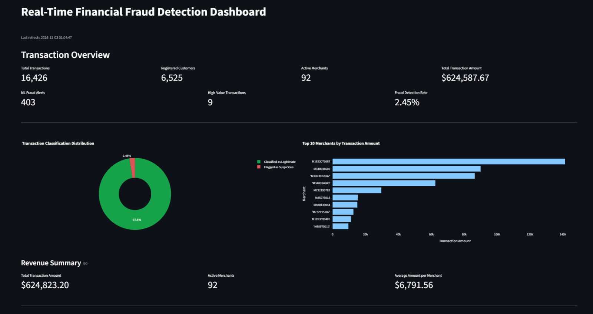
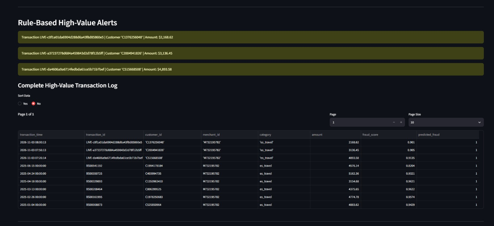
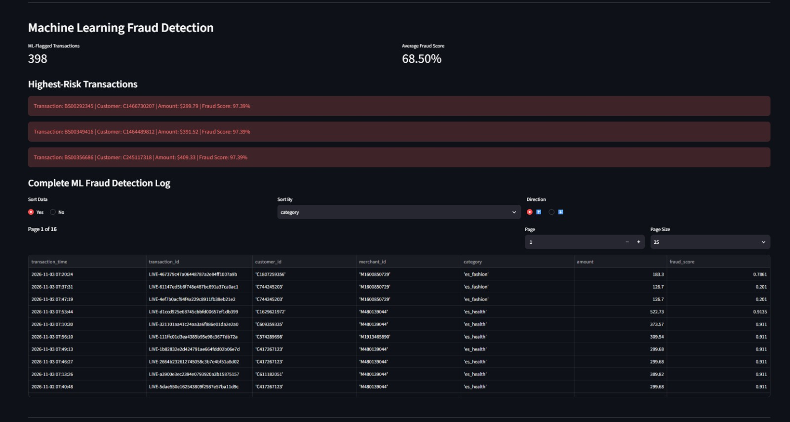
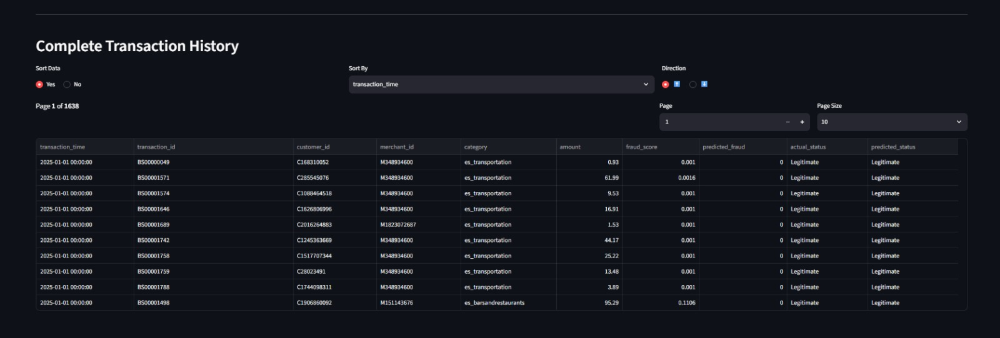

# Real-Time Financial Fraud Detection Pipeline

This project is an end-to-end simulated real-time financial fraud detection pipeline built using BankSim transaction data.

Historical transactions are loaded into PostgreSQL, while a separate transaction sample is continuously sent to Apache Kafka in batches of 5–10 records every 5–10 seconds.

PySpark Structured Streaming processes incoming transactions using a Random Forest model trained with Spark MLlib. The predictions are stored in PostgreSQL alongside the historical predictions and displayed through a Streamlit dashboard.

## Tech Stack

- Python
- Apache Kafka
- PySpark Structured Streaming
- Spark MLlib
- PostgreSQL
- Streamlit
- Docker

## How It Works

The pipeline looks like:

BankSim Dataset → Python Producer → Apache Kafka → PySpark Structured Streaming → PostgreSQL → Streamlit

I use `main.py` to sample and load 10,000 historical transactions into PostgreSQL while preserving the original fraud distribution.

A separate sample of 10,000 transactions is then used by `transactions.py` to simulate incoming transactions through Kafka.

Spark processes the incoming events through three independent queries:

- Random Forest inference to predict potentially fraudulent transactions.
- Rule-based monitoring to flag transactions with amounts of 1,500 or more.
- Merchant-level transaction aggregation for revenue monitoring.

The predictions are stored in the same PostgreSQL table as the historical predictions, allowing the dashboard to display everything in one cumulative view.

## Machine Learning

I trained a Random Forest classifier using Spark MLlib with transaction amount, simulation step, and merchant category as features.

To address the imbalance between fraudulent and legitimate transactions, I applied class weighting and selected the classification threshold using validation data, targeting at least 80% recall.

The final test results are:

| Metric | Result |
|---|---:|
| PR-AUC | 0.73 |
| Precision | 36.84% |
| Recall | 84.00% |
| F1-score | 51.22% |
| Accuracy | 98.00% |

The evaluation used a held-out test set of 2,001 transactions, including 25 fraudulent transactions.

## Dashboard

The Streamlit dashboard includes:

- Total transactions, customers, and merchants
- Transaction classification distribution
- Top 10 merchants by transaction amount
- Rule-based high-value transaction alerts
- ML fraud alerts and fraud scores
- Unified transaction history with actual and predicted fraud status

## Dashboard Preview

### Transaction Overview

### High-Value Alerts

### ML Fraud Detection

### Complete Transaction History

## Demo

[Watch the Project Demonstration](https://drive.google.com/file/d/1Y6MNYrWfvNHH63DPnteDIzsTWdD830yQ/view?usp=sharing)

## Kafka Topics

- `banksim_transactions` - incoming transaction events
- `banksim_scored_transactions` - transactions with ML predictions
- `banksim_ml_fraud_alerts` - transactions flagged by the ML model
- `banksim_flagged_alerts` - high-value transactions
- `banksim_merchant_revenue` - merchant-level revenue aggregates